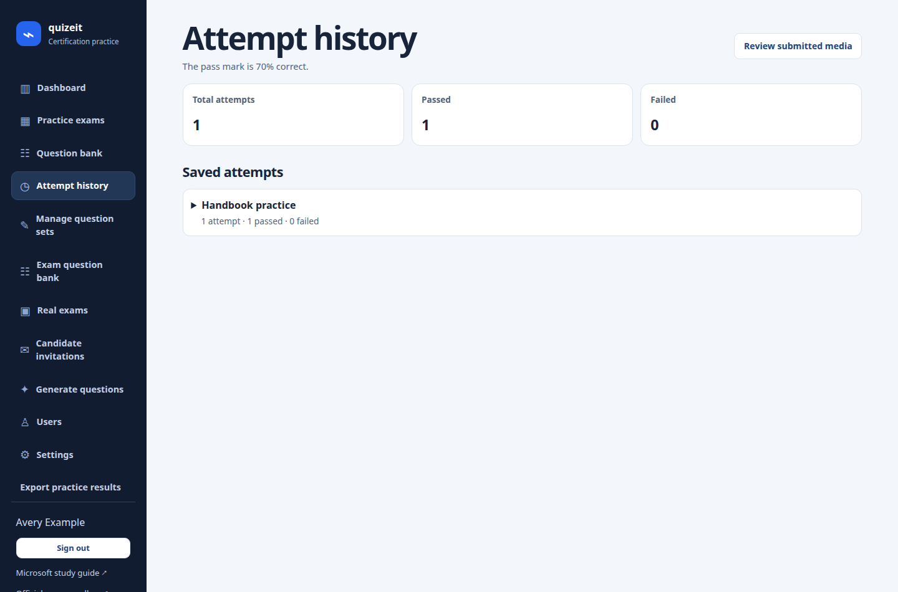

# Attempt history

**Attempt history** lists your submitted practice attempts. The summary cards count attempts and their outcomes. **Saved attempts** groups results by question set and shows how many passed, failed, or are pending. Expand a set, then select **View details** next to the attempt date you want.

## Read the result

- The score header shows the submission date, pass mark, and score or **Pending review**. The practice pass mark is **70%**.
- **Answer breakdown** counts **Correct**, **Incorrect**, **Incomplete**, **Unanswered**, and any answers awaiting review or awarded partial credit.
- **Score by domain** groups correct answers by subject. **Review answers → Show** filters the list by all, missed, flagged, or an individual status. **Missed questions** includes any answer without a **Correct** status.
- Expand a question to compare **Your answer** with **Correct answer**, read the explanation, or play a submitted video. Where available, **Explain with ChatGPT** opens an additional explanation and **Refresh explanation** regenerates it.
- **Attempt activity** shows recorded question time and run counts. **Activity by programming language** separates edits, saves, active editing time, and example, custom, and grading runs. Open **Run history** for the time, question, result, CPU usage, peak memory, and limits for each recorded run. Some older attempts lack these measurements.
- To try a completed set again, open its current result from **Practice exams** and select **Retake set**. Earlier submissions remain in history.

Administrators can open **Review submitted media** here to review submitted practice recordings. Use [Review exam submissions](results.md) for invited exam results and evidence.
