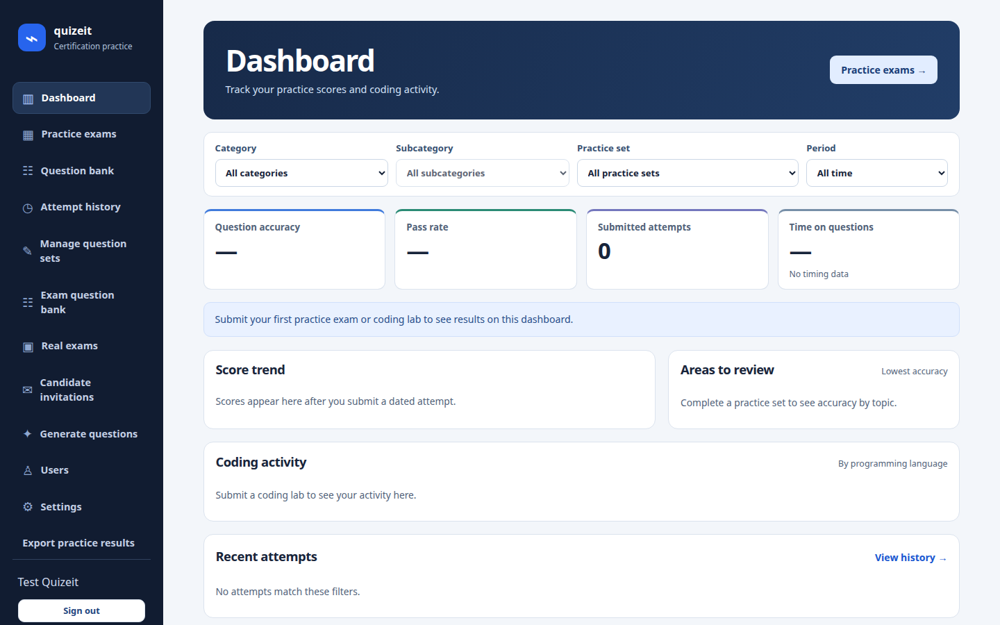

# Dashboard

Open **Dashboard** to review your own submitted practice activity. Use **Practice exams** at the top to start or resume a set.

## Filters

| Control | How to use it |
| --- | --- |
| **Category** | Choose a set category or **All categories**. |
| **Subcategory** | After selecting a category, choose one of its subcategories or keep all subcategories. |
| **Practice set** | Narrow the report to a set you've submitted. Changing the category or subcategory resets this selection. |
| **Period** | Choose **All time**, **Last 7 days**, **Last 30 days**, or **Last 90 days**. The rolling periods include today. |

## Practice totals and charts

- **Question accuracy** shows correct answers as a percentage of scored questions. The note gives the counts.
- **Pass rate** shows the share of graded attempts that passed. Attempts still awaiting video review are excluded from this percentage. Practice uses a 70% pass mark.
- **Submitted attempts** counts submissions in the current filters. The note shows how many distinct sets they cover.
- **Time on questions** totals the recorded time with questions visible. Older attempts may have no recorded time.
- **Score trend** shows up to 12 recent graded attempts in date order. Choose a point to see the set, date, and score. Select **Review attempt** for the full result.
- **Areas to review** shows up to four domains with missed questions, ordered by lowest accuracy. Each row shows accuracy and the number missed out of the number scored.
- **Coding activity** groups recorded activity by language. **Active editing** is the recorded editing time. **Edits** and **Saves** are recorded editor actions. **Example runs** use the author's visible tests, **Custom runs** use your own input, and **Grading runs** occur at submission. A dash means that editor measurement was unavailable.
- **Recent attempts** shows the five newest results in the current selection. Select a row to open it, or use **View history** to open [Attempt history](attempt-history.md).

If the dashboard is empty, submit a practice set or widen your filters.
