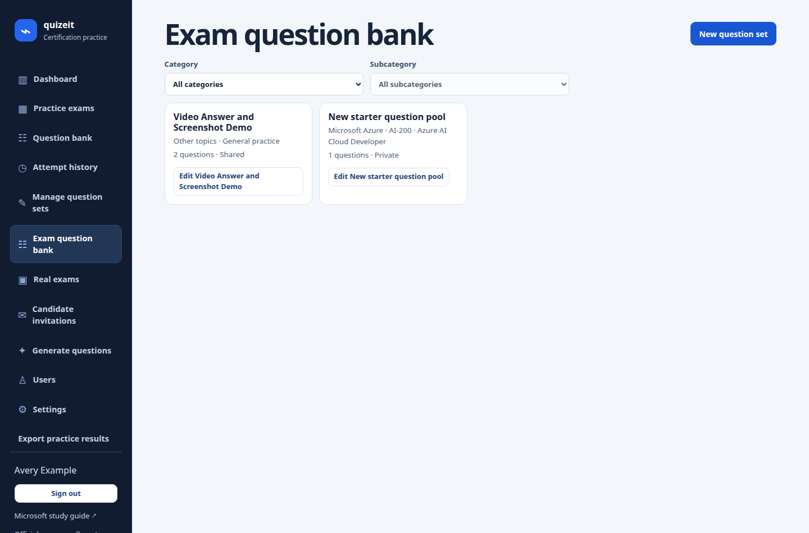

# Exam question bank

The **Exam question bank** is available to administrators and the owner. It holds the source sets for invited exams.

1. Select **New question set** to create a source set. Choose its title, category, subcategory, and optional **Difficulty (1–10)**.
2. Use **Add question** to build the pool. Set **Question difficulty** on items that need a different level. If a question and its set both omit difficulty, Quizeit treats it as **5** when selecting questions for an exam.
3. Select **Save question set**. Use the **Category** and **Subcategory** filters to find the set later. Open its **Edit** link to update the pool. [Question set controls](question-sets.md) · [Question type and answer fields](questions.md)
4. Open [Real exams](first-exam.md) and select the source set, how many questions to draw, and the **Minimum difficulty**. A saved exam keeps the pool it captured at creation. Create a new real exam to use later edits to the source set.

Candidates see only the questions assigned to their invitation. The question bank editor and answer keys are available to administrators and the owner.
