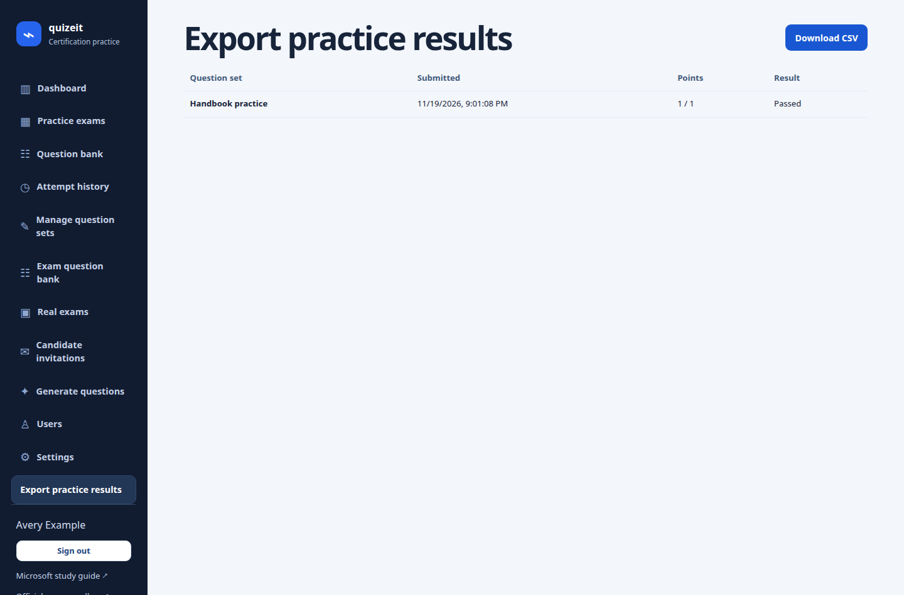

# Export practice results

Open **Export practice results** to download your own submitted practice scores. The menu is available to administrators, the owner, and accounts assigned the **Practice results exporter** role when the feature is enabled. The owner can assign that role in [Users](setup.md).

The page lists each attempt's **Question set**, **Submitted** date, **Points** earned out of possible, and **Result**. Select **Download CSV** to save **practice-results.csv**. The file separates the two point values into **Points earned** and **Points possible** columns. A set you retake can have multiple rows, one per attempt. The export contains practice summaries for your account.

If the page shows **No practice results to export**, submit a practice set and return. Pending video attempts appear only if an administrator turns on **Include attempts pending video review** in [Settings](settings.md#plugins).
