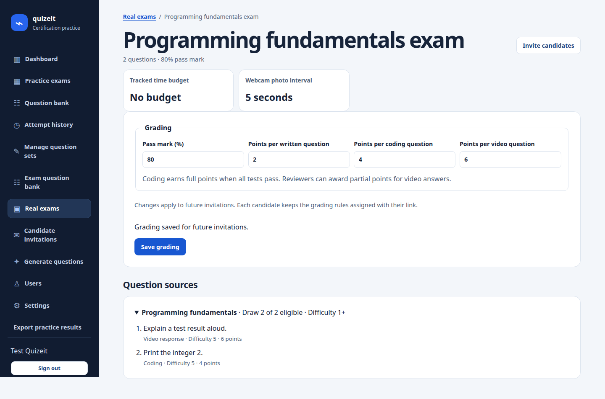

# Create your first real exam

Sign in as an administrator or the owner. This walkthrough uses an example called **New starter orientation**.

## 1. Prepare the questions

Open **Exam question bank → New question set**. Enter **New starter orientation** as the set title, **Onboarding** as the category, and **Workplace basics** as the subcategory. Set difficulty to **5**.

1. Select **Add question** and keep **Single choice**. Ask **Where should a new starter find the team handbook?** Add **In the team workspace** and **In an old email attachment**. Mark the team workspace option as correct and add an explanation.
2. Select **Add question** again and choose **Video response**. Ask **What would you do if you could not find the handbook?** Add grading guidance and set the maximum recording length to 30 seconds.
3. Select **Save question set**. Use [Add, edit, and delete questions](questions.md) for the other formats and settings.

## 2. Build the exam

Open **Real exams** and fill out **Create a real exam**.

| Field | What it controls |
| --- | --- |
| **Exam title** | The name candidates see when they open their invitation. |
| **Tracked time budget in minutes** | Displays a time budget during the exam. Enter 0 to hide it. |
| **Webcam photo interval in seconds** | How often webcam photos are taken while the written and coding section is active. Choose 5–300 seconds. |
| **Pass mark (%)** | The percentage of available points a candidate needs to pass. For this example, enter 80. |
| **Points per written, coding, or video question** | The weight assigned to each type. For this example, set written to 4 and video to 6. |
| **Question set** | The exam bank set Quizeit draws from. Select **New starter orientation**. Use **Add question set** to draw from another set. |
| **Number of questions** | How many questions to draw from that set. Enter 2 for this example. An exam can draw up to 60 questions in total. |
| **Minimum difficulty (1–10)** | The lowest difficulty eligible for selection from that set. Enter 1 here. Check the eligible count under each row. |

Select **Create exam**. Quizeit saves the eligible question pools and randomly selects questions from them for each candidate invitation. In mixed exams, written and coding questions come before video questions.

## 3. Check the exam before inviting anyone

Open **Saved exams → View details** to check the question count, time budget, grading, and eligible questions. Expand a row in **Question sources** to see the questions. To change the pass mark or points, edit **Grading** and select **Save grading**. The new rules apply to invitations created afterward.

Next, [invite a candidate](invitations.md). After they submit, [open and grade the attempt](results.md).
