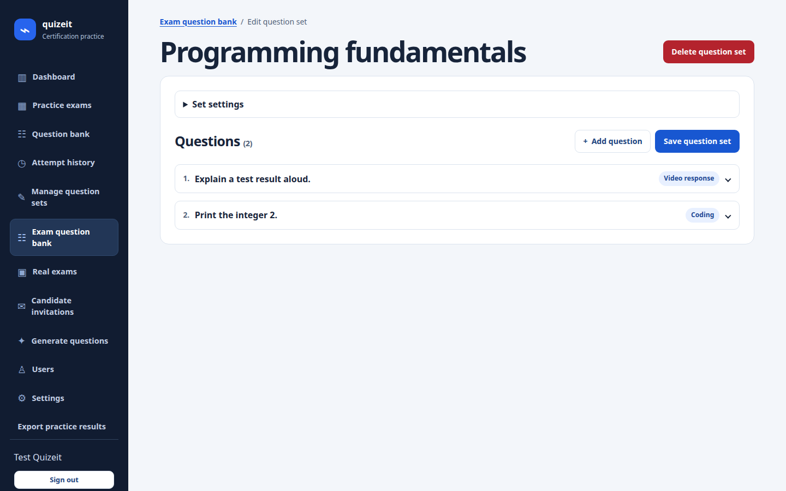

# Create your first graded exam

Sign in as an administrator on a [running Quizeit installation](setup.md). This walkthrough creates a sample exam called **Programming fundamentals exam** with one coding question and one video question.

## 1. Create the exam question set

Open **Exam question bank → New question set**. Name it **Programming fundamentals**, choose a category and subcategory, and set difficulty to **5**. Use **Add question** to add the following questions.

| Type | Question and settings |
| --- | --- |
| Coding | Prompt **Print the integer 2.** Choose Python, enter `print(2)` as the reference solution, and add a visible example with empty standard input and `2` as expected output. Enter an explanation. |
| Video response | Prompt **Explain a test result aloud.** In **Grading guidance**, ask for a clear explanation of the expected and actual output. Set a recording limit, such as 30 seconds. |

Select **Save question set**. Select a question row to expand and edit it. To add written questions, choose single choice, multiple select, matching, ordering, or short answer and enter the expected answer and explanation.

Use **Manage question sets** for practice material and **Exam question bank** for real exams. You can also open **Generate questions**, choose **Real exam**, and review the resulting questions in the exam bank. [Question generation and study files](../using-the-app.md#generate-a-question-set)

## 2. Create and configure the exam

1. Open **Real exams**.
2. Name the exam **Programming fundamentals exam**. Select **Programming fundamentals**, draw **2** questions, and set minimum difficulty to **1**.
3. Choose the webcam photo interval and the tracked time budget, then create the exam. Enter zero to hide the budget. Quizeit draws questions from eligible pools for each invitation. A question without its own difficulty inherits its set's difficulty.
4. In **Saved exams**, select **View details**. Set the pass mark to **80%**, coding to **4** points, and video to **6** points. Select **Save grading** before inviting the candidate. Grading changes apply to future invitations.

## 3. Invite the candidate

Open **Candidate invitations**, choose the exam, and enter the candidate's email. Set the number of days the invitation stays valid. Select **Create invitation link** and use the copy icon to share it, or choose **Send invitation email** when email delivery is configured. The list shows when each invitation expires.

For a demo, open the invitation in a separate browser profile and use the same email. Follow [Take an invited exam](take-exam.md), run the Python example, record the video, and submit.

## 4. Grade and review the exam

1. Return to **Real exams → Review exam submissions** as an administrator.
2. Open the candidate's submission. Coding earns its full points when all grading tests pass. The overall result stays **Pending review** while a submitted video needs grading.
3. Expand the video answer, play the recording, enter the points awarded, and select **Save points**. With the example marks above, **4** coding points and **4** video points earn **80%**.
4. Open **Exam evidence** to review the screenshot and webcam galleries and the timeline of sharing and focus changes.

