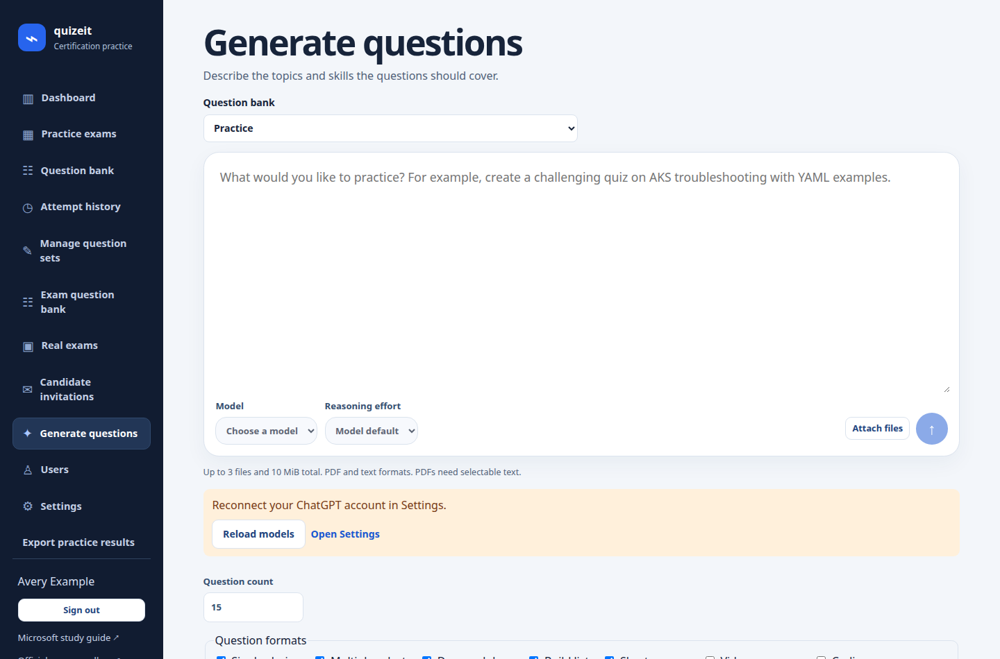

# Generate questions

Open **Generate questions** when you want a model to draft a question set. If the model menu is empty, select **Open Settings** to check your connection or **Reload models** to refresh the list.

## Fill in the request

| Control | What to enter |
| --- | --- |
| **Question bank** | Administrators choose **Practice** or **Real exam**. Learners generate practice sets. |
| **Difficulty (1–10)** | Appears for a real exam set. Choose the difficulty the saved set will use for exam selection. |
| **Question set prompt** | Describe the subject, audience, level, and skills to test in up to 6,000 characters. A supported attachment can supply the material when the prompt is empty. |
| **Model** | Choose one of the models available to your account. This determines available formats, attachment support, and reasoning options. |
| **Reasoning effort** | Leave **Model default** or choose one of the levels offered by that model. |
| **Attach files** | Attach up to three nonempty files totaling 10 MiB. Remove a file using the × beside it. |
| **Question count** | Enter 1–60. The starting value is 15. Request at least one question for each selected format. |
| **Question formats** | Check the types to include. Models may offer different formats. |

With ChatGPT connected, you can attach PDFs with selectable text or TXT, Markdown, CSV, JSON, and YAML files. Quizeit extracts text up to 60,000 characters total. Hosted tools also accept Word, PowerPoint, and Excel formats for generation. For files kept for later use, see **Study files** under [Settings](settings.md#openai-hosted-tools).

## Generate, check, and use the set

Select the up arrow labeled **Generate question set**. The activity panel shows progress. Use **Cancel generation** while it is available. Wait for the saved result before closing the page.

The result shows the title, model, category, subcategory, and question count. Where available, expand **Web sources used** and check the cited material. **Start generated set** opens practice questions. **Edit in exam question bank** opens a real exam set for review. Check prompts and answer keys before use. **Saved generated sets** lists your generated practice sets so you can reopen them later.
