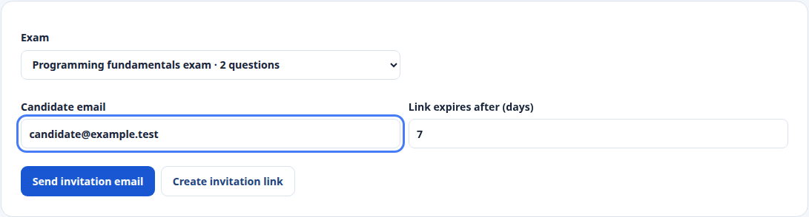

# Invite candidates to an exam

Administrators and the owner can create, send, and copy invitations. The candidate uses the personal link to access the assigned exam.

## Create or email an invitation

1. Open **Candidate invitations** from the sidebar, or choose **Invite candidates** from the exam's details.
2. Select the **Exam** and enter the **Candidate email**. Enter the exact address the candidate will use.
3. Set **Link expires after (days)**. The default is 7 days. Choose any whole number from 1 to 365.
4. Select **Create invitation link** to share it yourself. Under **All invitations**, use the copy icon in the invitation's row. If automatic copying is unavailable, copy from the link field Quizeit displays.
5. If **Send invitation email** is available, use it to have Quizeit send the invitation. If delivery fails, use the copy icon to share the same link.

## Check the invitation status

**All invitations** lists the candidate, exam, status, expiry, and available actions. Select **Refresh** to see recent changes.

| Status or action | What it means |
| --- | --- |
| **Invited** | The candidate can still start. Use the copy icon to send the existing link again. |
| **Started** | The candidate has claimed the link. They can return to the exam page in the same browser profile for up to 24 hours after claiming. |
| **Expired** | The link passed its start deadline. Create a new invitation if the candidate still needs to take the exam. |
| **Submitted** | The candidate finished the exam. Select **Review submission** to open the result. |
| **Replace link** | An older unused invitation may need a new link. Confirm the replacement and send it to the candidate. Its expiry stays the same. |

After a candidate starts, expand **Verification details** to see the start time, recorded IP address, browser information, and approximate location if they chose to share it.

For the candidate's steps, share [Take an invited exam](take-exam.md) with the invitation.
