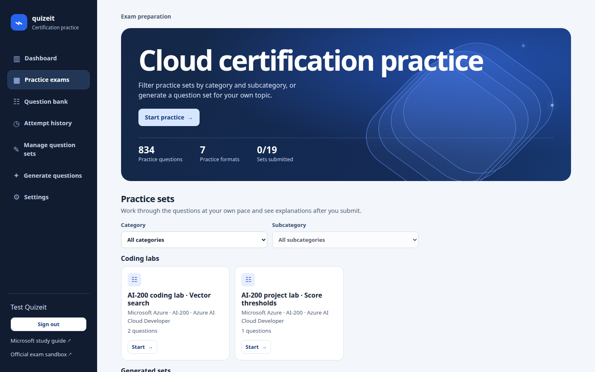

# Practice and review your results

1. Open **Practice exams** and choose a set. Use the category and subcategory filters to narrow the list.
2. Answer questions and use **Flag for review** to mark items to revisit. Use **Pause timer** to stop a timed practice attempt, and resume when ready. Reopen the same set to continue the saved draft.
3. Select **Submit set** and review your score, explanations, and missed questions. Open **Attempt history** to revisit a submission, or view progress trends on **Dashboard**.

Practice sets use no exam screen capture or webcam photos. Video practice questions open the camera when you select **Start camera**.

## Record a video practice answer

Open **Video Answer Practice** to try the recording controls. Select **Start camera**, check your preview, then choose **Start recording**. Review the recording and select **Submit video** to attach it to the draft. Submit the set when you are ready for review.

## Create and export practice material

Open **Manage question sets → New question set**, add questions, and save. Use **Generate questions** for AI-assisted authoring. Check the generated prompts and answer keys before using the set. You can set a time budget for a set and a specific time on an individual question. [Manage practice question sets](question-sets.md)

If your account has export access, open **Export practice results → Download CSV** for a spreadsheet of your own practice scores. The owner can grant the **Practice results exporter** role when that plugin is enabled.
