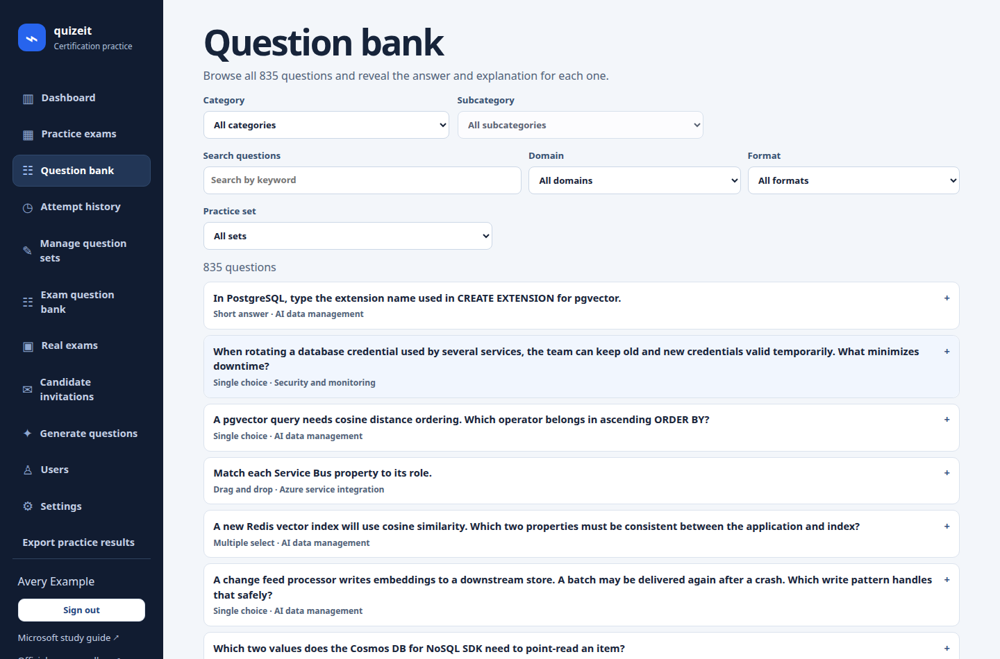

# Question bank

Use **Question bank** to browse shared practice questions and questions from your own private practice sets. For administrator-only real exam material, open [Exam question bank](exam-question-bank.md).

| Control | What it does |
| --- | --- |
| **Category** and **Subcategory** | Filter on the labels of the set that contains each question. Changing either resets **Practice set** to **All sets**. |
| **Search questions** | Matches text in question prompts and case study titles. Search ignores capitalization. |
| **Domain** | Filters by the question's subject area, including **General practice**. Domains are assigned on each question. |
| **Format** | Filters by answer type, such as **Single choice**, **Drag and drop**, or **Video response**. |
| **Practice set** | Shows questions from one set. Leave **All sets** selected to search across the matching practice sets. |
| **Show more questions** | Loads 40 more matching questions. Changing a filter returns the list to the first 40. |

Select a row to expand the prompt, case study, exhibits, and available answer options. Select **Reveal answer** to see the answer key and explanation or the grading guidance for video. For other formats, use **Explain with ChatGPT** if a model is connected. For a saved explanation, use **Refresh explanation** to generate a new one. [Model settings](settings.md#chatgpt-explanations)

Use [Manage question sets](question-sets.md) to edit a question you have permission to change.
