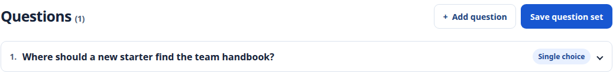

# Create and manage question sets

## How questions are organized

A **question set** contains individual **questions**. The **category** and **subcategory** are labels on the set and appear as filters when browsing. For example, **New starter orientation** can have category **Onboarding** and subcategory **Workplace basics**. Inside that set, each question has its own prompt, type, answer, and domain.

Choose the area based on who will use the questions.

| Area | What it contains | Who manages it |
| --- | --- | --- |
| **Manage question sets** | Practice material people can open from **Practice exams**. Private sets are visible to their creator. Shared sets are visible to signed-in learners and staff. | Learners manage their own private sets. Administrators also manage shared sets and can select **Shared bank** when creating a practice set. |
| **Exam question bank** | Question sets used as sources when creating real exams. | Administrators and the owner. Candidates see the questions assigned to them through their invitation. |

**Question bank** in the sidebar is for browsing practice questions and answers. **Manage question sets** is where you make changes. A saved set stays in the bank where it was created.

## Create a question set

1. Open **Manage question sets** or **Exam question bank** and select **New question set**.
2. In **Set settings**, enter the **Set title**. Select an existing **Category** and **Subcategory**, or select **New category** or **New subcategory** and enter a name.
3. Select a difficulty from 1 to 10 if useful. A real exam question inherits the set difficulty unless you set it on that question. The default difficulty for real exam selection is 5 when both fields are empty.
4. Set a total time budget for a practice set if needed. When creating a shared practice set as an administrator, choose the **Visibility** before saving.
5. Select **Add question**, fill its required fields, and add any others. Select **Save question set**. [Create and edit individual questions](questions.md)

## Edit a set or remove it from the catalog

Use the category and subcategory filters to find the set, then select **Edit** beside its name. Expand **Set settings** to change the title, labels, difficulty, or limits. Expand a question row to edit that item. Select **Save question set** to apply your changes.

Use **Delete question set** and confirm to remove the set from the catalog. Saved attempts and results remain available. Edits to an exam question set apply when a new real exam is created from it. A real exam that already uses the set keeps the question pool it captured when created.

## Generate questions with AI

If a model is available to your account, open **Generate questions**. Administrators can choose **Practice** or **Real exam**. For a real exam set, also choose a difficulty.

1. Pick a model. Describe the topic, intended audience, and kinds of questions you want. Attach study material if the chosen model offers **Attach files**.
2. Choose how many questions to generate and select the formats. Allow at least one question per format.
3. Select **Generate question set** and wait for the saved result. Open the set in **Manage question sets** or **Exam question bank** and check the answer keys before sharing it or using it in an exam.
