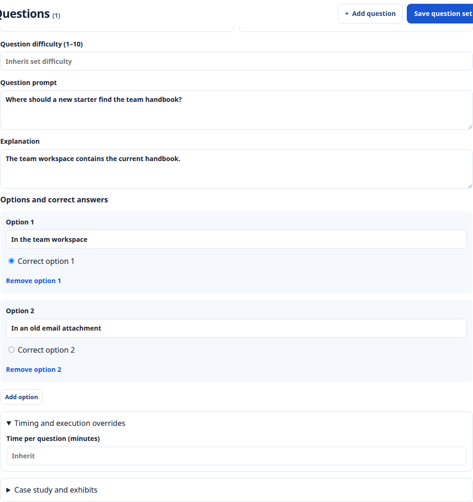

# Add, edit, and delete questions

## Add a question

Open a set in **Manage question sets** or **Exam question bank**, then select **Add question**. Each new question starts as **Single choice**. Choose its **Question type** before entering the answer fields. The prompt, domain, and explanation or grading guidance describe what the person should answer and how it will be reviewed.

1. Choose a **Domain** for the question. Use **General practice** if the other domains do not apply. The domain groups questions for browsing or reporting.
2. Fill in the **Question prompt**. Add an **Explanation** for review, or **Grading guidance** for a video response.
3. Fill in the fields for the selected type. For exam bank questions, optionally choose a **Question difficulty**. Leave this blank to use the set difficulty.
4. Select **Save question set**. You can add or edit several questions before saving.

## Choose the right question type

| Type | What to enter |
| --- | --- |
| **Single choice** | Add at least two distinct options and mark one **Correct option**. |
| **Multiple select** | Add at least two correct options and one incorrect option. Mark every correct option. The response must match the full answer key. |
| **Drag and drop** | Add at least two matching pairs. Put the text to match on the left and its correct match on the right. Candidates can also use dropdowns. |
| **Build list** | Add at least two steps in the correct order. Quizeit gives the steps to the person taking the question to arrange. |
| **Short answer** | Enter each accepted answer as a separate row. Add alternate wording if it should also count. Quizeit ignores capitalization and normalizes whitespace. |
| **Video response** | Enter grading guidance and choose the maximum recording length. A reviewer grades the submitted recording. |
| **Coding** | Select a language, supply the reference solution, and add a visible example with the input and expected output. Starter material is optional. Mark additional grading cases as **Hidden grading test** if they should only be used for scoring. |

Open **Case study and exhibits** when the prompt needs background or reference material. Check **Include a case study** to add a title and background. Use **Add exhibit** to show material with the case study or individual question.

## Set timing and execution overrides

Open **Timing and execution overrides** on a question to set its individual time budget. The set's **Total set time** is the budget for the complete practice attempt. An explicit question budget is tracked separately. Coding questions also offer CPU time, wall-clock time, and memory fields. A value you enter on the question takes precedence over the corresponding set or shared execution setting.

## Update or delete a question

1. Open the set and select an existing question row to expand it. Select the row again to collapse it.
2. Update the prompt, answers, explanation, or settings. If you change the question type, fill the answer fields for the new type again.
3. To remove a question, expand it and select **Delete question**. Choose another question to keep at least one in the set.
4. Select **Save question set** to apply edits and deletions. If Quizeit reports that someone else saved the set, reopen it before reapplying your edits.
