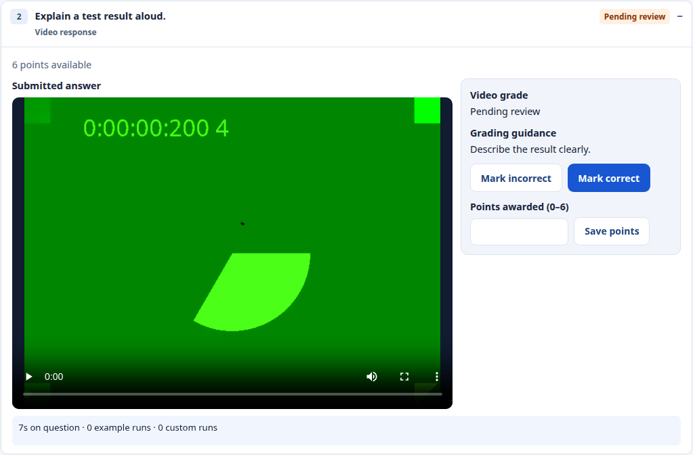

# Review exam submissions

Administrators and the owner can open submitted answers, assign video marks, and review exam evidence.

## Open a submission

Go to **Real exams → Review exam submissions** and select **Review submission** beside a candidate. You can also open it from their row in **Candidate invitations**. Review their overall score, answer breakdown, and responses.

## Finish grading

Written answers are scored against the set's answer keys. A coding answer earns its allotted points when all grading tests pass. The result stays **Pending review** while a submitted video needs grading.

1. Under **Review answers**, expand the video question and play the recording.
2. Enter **Points awarded** and choose **Save points** to give partial credit. **Mark correct** awards full points and **Mark incorrect** awards zero.
3. Repeat for each pending video. The final score is points earned divided by points available. In the [first exam example](first-exam.md), 4 written points plus 4 video points out of 10 earn 80%.

## Review exam evidence

Open **Exam evidence** to browse the written and coding section's **Screenshots** and **Webcam photos**. Each button gives the number of images available. Select a thumbnail to enlarge it. Use **Previous**, **Next**, or **Close** in the viewer, and **Show more** in the gallery to load additional images. Expand **Sharing timeline** to compare image timestamps with documented sharing and focus changes. A **Left exam** count shows recorded departures. Video responses appear under **Review answers**.
