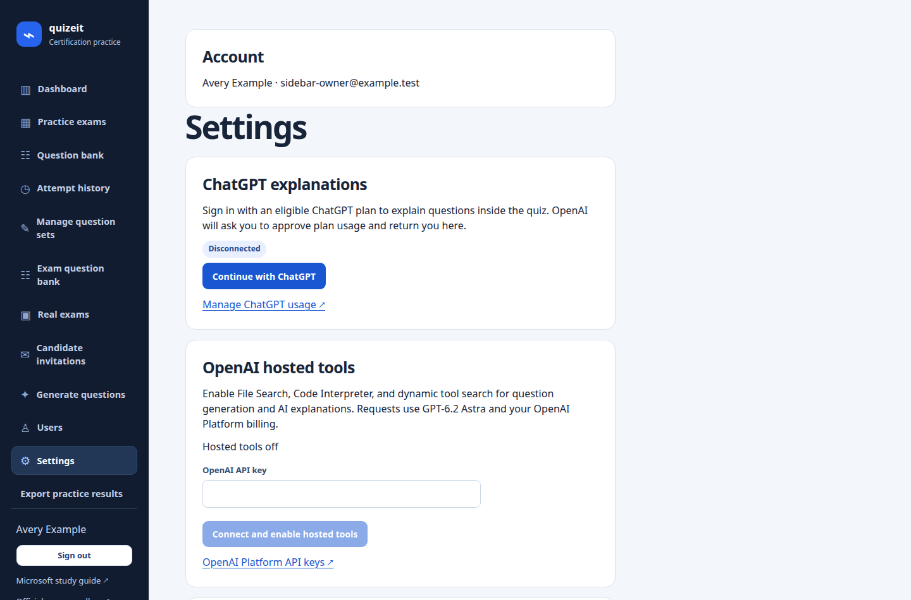

# Settings

Open **Settings** to check your account, connect AI features, and see the controls available to your role.

## Account

Check the displayed name and email to confirm which Quizeit account is signed in. If **Connect Google** is available, select it and finish the sign-in prompt to link Google. **Google is connected** confirms the link. An administrator can change eligible account details in [Users](setup.md).

## ChatGPT explanations

Use **Continue with ChatGPT** to sign in with an eligible ChatGPT account and approve plan usage. The status shows whether it is connected and may display the account email. **Use a different account** starts sign-in again. **Disconnect** ends the connection. **Manage ChatGPT usage** opens your usage page. If the screen offers **Open 127.0.0.1 for ChatGPT sign-in**, use that button on the device where Quizeit runs.

A connection can provide models for [Generate questions](generate-questions.md) and **Explain with ChatGPT** in the question bank and practice results.

## OpenAI hosted tools

In **OpenAI hosted tools**, enter the key for the OpenAI Platform account approved for this use and select **Connect and enable hosted tools**. If you already connected an account, the field becomes **Replace OpenAI API key**. Hosted requests and study file storage use your Platform project's billing.

- **Switch to ChatGPT OAuth** turns hosted tools off and uses the ChatGPT connection for supported requests. Use **Enable hosted tools** to switch back with the saved key.
- **Choose a study file → Upload study file** adds a file to the connected OpenAI project. Supported extensions are PDF, TXT, Markdown, Word DOCX, PowerPoint PPTX, JSON, and PY, up to 15 MiB per file. These are files kept for repeated use. [Attachments for one generation request](generate-questions.md#fill-in-the-request)
- **Refresh file status** updates each file's status. Wait for **Ready** before expecting it to appear in File Search. **Indexing failed**, **Indexing canceled**, and **Status unavailable** mean the file could not be confirmed ready.
- **Remove** deletes that study file from the connected project. **Remove saved API key** removes Quizeit’s saved connection.

## Attempt storage

The owner sees **Import previous browser attempts**. Use it in the same browser profile that holds the older attempts. The button reports whether it found history to import. Open [Attempt history](attempt-history.md) to view results.

## Judge0 execution limits and exam timer

Administrators and the owner see these shared controls. Use **Apply to** to select **Global defaults**, a language, or a shared practice set.

| Setting | Meaning | Allowed values | Starting global default |
| --- | --- | --- | --- |
| **CPU time (seconds)** | Processor time allowed for a single test. | 1–15 | 3 |
| **Wall-clock time (seconds)** | Total elapsed time allowed for a single test. | 1–20 | 8 |
| **Memory (MiB)** | Memory allowed for a single test. | 32–500 | 250 |
| **Exam timer (minutes, 0 = off)** | Time budget for a new practice attempt. This field appears for global defaults and practice sets. | 0–600 | 0 |

Select **Save execution limits** to apply your changes. For a saved language or set override, **Remove override** clears that override. A language override takes precedence over global defaults. A practice-set override takes precedence over a language override. Limits entered in the question-set editor and then on the specific question take precedence over these shared settings. Real exams have a separate tracked time budget set in [Real exams](first-exam.md).

## Plugins

Authorized administrators see settings for enabled features. For **Practice results export settings**, turn on **Include attempts pending video review** to include those rows in the export, then select **Save settings**. The setting is off by default. [Export practice results](export-practice-results.md)
