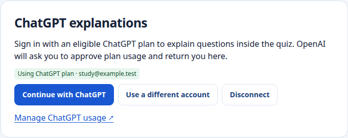
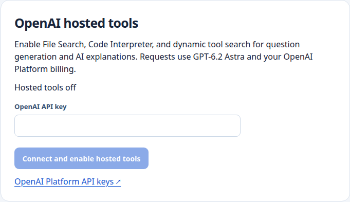
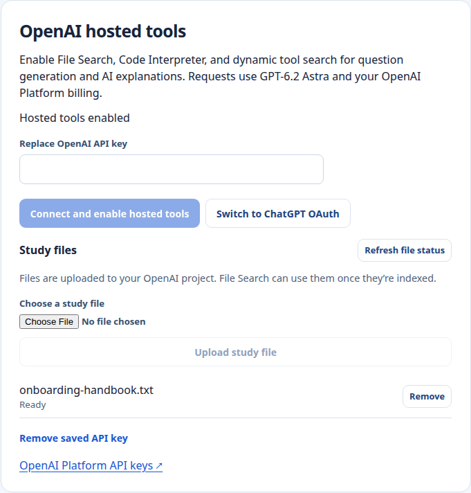
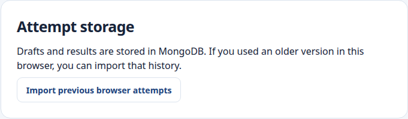
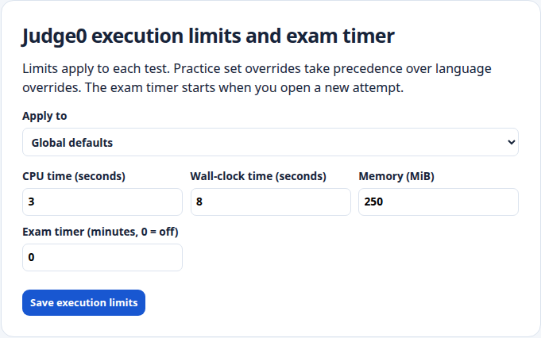
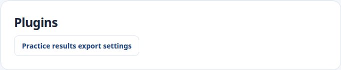

# Settings

Open **Settings** from the Quizeit sidebar. **Account** and the AI connection panels apply to your signed-in account. The designated owner also sees the legacy attempt import. Administrators and the owner can change shared execution limits and configure enabled plugins. [Accounts and roles](setup.md#who-can-see-and-do-what)

## Account

The **Account** card shows the name and email on your Quizeit account. If your organization has enabled Google sign-in, you can link an existing password account.

1. Sign in to Quizeit with your current email and password.
2. Open **Settings → Account** and select **Connect Google**.
3. On the Google sign-in screen, choose the verified Google account with the same email as your Quizeit account. Finish signing in and return to Quizeit.
4. Look for **Google is connected**. Next time, use **Continue with Google** on Quizeit’s sign-in page.

If the button is missing, ask the person who manages Quizeit about enabling Google sign-in. To change your name or email, ask someone who can edit your account in [Users](setup.md#edit-deactivate-or-restore-a-user).

## ChatGPT explanations

Use this connection to use an eligible ChatGPT plan for **Explain with ChatGPT** and [Generate questions](generate-questions.md). Quizeit displays the connected ChatGPT account's email when available.

1. Open **ChatGPT explanations** and select **Continue with ChatGPT**. If Quizeit offers **Open 127.0.0.1 for ChatGPT sign-in**, follow it from the device where Quizeit runs, then start sign-in.
2. On the OpenAI sign-in page, choose the ChatGPT account you want to use and approve Quizeit’s request to use the plan. You return to **Settings**.
3. Check for **Using ChatGPT plan**, then open a practice result or a question in **Question bank** to try an explanation. For generation, choose an available model under **Generate questions**.

- **Use a different account** starts a fresh sign-in so you can select another ChatGPT account.
- **Disconnect** clears the connection in Quizeit. If Quizeit says it disconnected locally, open ChatGPT Settings to check the app’s access.
- **Manage ChatGPT usage** opens ChatGPT’s usage page. If sign-in expires or the permission screen was canceled, start again from **Settings** and approve plan usage.

## OpenAI hosted tools

The hosted route uses an OpenAI Platform project. Quizeit offers **GPT-6.2 Astra · Hosted tools** in this mode. File Search can consult indexed study material. Code Interpreter can run supported analysis tasks, and tool search lets the model find additional tools during generation or explanation. API usage and hosted storage are tracked through the connected Platform project. Check its billing before enabling it. [OpenAI Platform billing](https://platform.openai.com/settings/organization/billing/overview)

### Get a Platform API key and connect it

1. Sign in to the OpenAI Platform. Select the organization and project your team wants to use for Quizeit. If you cannot access the project or create a key, ask its administrator for access. [OpenAI API keys and service accounts](https://developers.openai.com/api/docs/guides/api-keys)
2. Check the organization’s API billing or available API credits. If your ChatGPT plan offers API credits, follow OpenAI’s claim steps so they are applied to the organization you selected. [OpenAI Platform billing](https://platform.openai.com/settings/organization/billing/overview) · [OpenAI API credits guide](https://developers.openai.com/api/docs/guides/chatgpt-api-credits)
3. Open **API keys** in that project, select **Create new secret key**, and copy the secret when it appears. Keep it private. [OpenAI Platform API keys](https://platform.openai.com/api-keys) · [Official API key setup](https://developers.openai.com/api/docs/quickstart#create-and-export-an-api-key)
4. Return to Quizeit. Paste the secret into **OpenAI API key** and select **Connect and enable hosted tools**. **Hosted tools enabled** confirms the connection. In **Generate questions**, select the hosted model Quizeit offers.

If the key is rejected, check that it belongs to the intended project and that the project can use the model and file tools. For quota errors, check API billing and limits in that organization. When replacing a key, use **Replace OpenAI API key**. If existing study files belong to another project, remove them with the current connection before switching projects.

**Switch to ChatGPT OAuth** turns hosted tools off and uses the ChatGPT connection for supported requests. **Enable hosted tools** switches back with the saved key. To remove the saved key from Quizeit, first use **Remove** on its uploaded study files, then select **Remove saved API key**. To revoke the key itself, remove it in the originating Platform project. [OpenAI Platform API keys](https://platform.openai.com/api-keys)

### Bring in study material from another platform

If your source is in Google Drive, OneDrive, SharePoint, an LMS, or another service, use that service’s **Download** or **Export** option to save a document you are allowed to share. A PDF, Word document, or plain text export is a practical starting point. The supported routes are below.

| What you want to do | Where to put the file in Quizeit |
| --- | --- |
| Use it for one generated set | Open **Generate questions → Attach files**. Choose a model that supports attachments and select up to three files, 10 MiB combined. ChatGPT mode can use PDFs with selectable text and supported text files. Hosted mode also supports Word, PowerPoint, and Excel attachments. |
| Reuse it for future generation or explanations | Enable hosted tools, then open **Settings → OpenAI hosted tools → Study files**. Use **Choose a study file → Upload study file**. Quizeit sends the file to the linked OpenAI project for File Search. |

For **Study files**, Quizeit accepts PDF, TXT, Markdown, DOCX, PPTX, JSON, and PY. Each file can be up to 15 MiB, with up to 25 files in the list. Select **Refresh file status** to check indexing. **Ready** means the model can search it if it uses File Search. If the status remains **Indexing failed**, **Indexing canceled**, or **Status unavailable**, check the connection and file, then remove and re-upload if needed. [Official OpenAI File Search documentation](https://developers.openai.com/api/docs/guides/tools-file-search)

The **Study files** list shows files uploaded through Quizeit. For a document already stored in a different OpenAI project, use your copy of the source document and upload it here. For example, save an onboarding handbook as a PDF, upload it, wait for **Ready**, and ask **Generate questions** for a practice set based on that handbook. Review the generated questions and answers before using them. To author questions directly, use [Manage question sets](question-sets.md).

## Attempt storage

**Import previous browser attempts** is for drafts and results saved by an older Quizeit version in browser storage. The designated owner runs the import from the browser profile and Quizeit address that originally saved the data.

1. Sign in as the owner in that browser profile. Open Quizeit at the same address, including the same port.
2. Open **Settings → Attempt storage** and select **Import previous browser attempts**.
3. Look for **Previous attempts imported into your account**. Open **Attempt history** to see recovered results and **Practice exams** to resume any recovered drafts.

The import skips submissions already imported and keeps existing drafts for the same set. If it reports that no older attempts were found, try the original browser profile and address. Use this button for earlier Quizeit browser data. Study materials from other services follow the [file upload steps](#bring-in-study-material-from-another-platform).

## Judge0 execution limits and exam timer

Administrators and the owner use this panel to set limits for code runs and the default practice timer. Code execution limits apply to each test. They are distinct from the number of minutes a person spends answering questions.

### Choose what the setting applies to

| **Apply to** option | When to use it |
| --- | --- |
| **Global defaults** | Set the baseline execution limits and practice timer. |
| A **Language** | Set CPU time, wall-clock time, and memory for that language when a more specific limit does not apply. |
| A **Practice set** | Set execution limits and a timer for a shared practice set. |

### Enter and save the values

| Setting | Meaning | Allowed values | Starting global default |
| --- | --- | --- | --- |
| **CPU time (seconds)** | Processor time the running program can use on one test. | 1–15 seconds | 3 |
| **Wall-clock time (seconds)** | Elapsed time allowed from a test’s start to its finish. It must be at least as high as CPU time. | 1–20 seconds | 8 |
| **Memory (MiB)** | Maximum memory the running program can use on one test. | 32–500 MiB | 250 |
| **Exam timer (minutes, 0 = off)** | Tracked time budget for a new practice attempt. Choose 0 for an unlimited budget. The field appears for global defaults and practice sets. | 0–600 minutes | 0 |

Select **Save execution limits**. When a saved language or shared set override is selected, **Remove override** restores the inherited settings for that scope.

For code runs, Quizeit starts with the global defaults, applies the selected language's override, then applies the shared practice-set override. Values entered directly in **Manage question sets**, followed by values on the individual question, are applied last. For example, a 4-second language CPU limit becomes 2 seconds on a question with its own 2-second CPU limit. Invited exams use the [tracked time budget in Real exams](first-exam.md) for the overall attempt.

## Plugins

The **Plugins** panel appears for administrators and the owner when enabled features expose settings.

Select **Practice results export settings**. Turn on **Include attempts pending video review** if those attempts should appear in the export. It starts off. Select **Save settings**, then open [Export practice results](export-practice-results.md) and select **Download CSV**. The export contains the signed-in account’s own practice results. The owner can grant another user the **Practice results exporter** role in [Users](setup.md).
