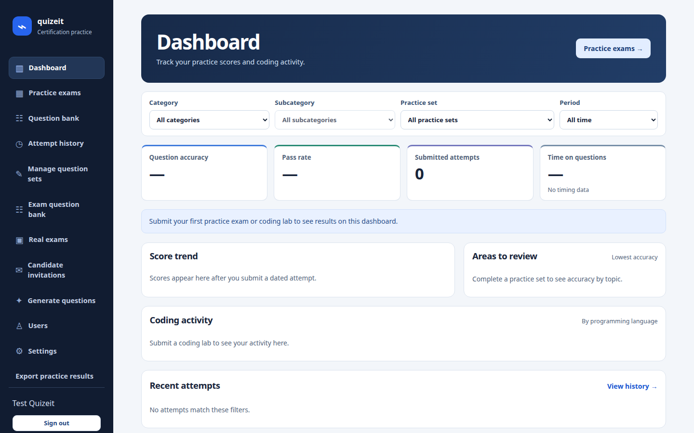

# Set up Quizeit

## Install and sign in

1. On a Linux host with Docker Compose and Node.js 22.13 or later, obtain the [Quizeit repository](https://github.com/misyaath/quizeit) and open a terminal in its folder. Install FFmpeg on the host if you plan to accept video answers. Quizeit uses its `ffprobe` utility to validate uploads.
2. Install dependencies and start the full system.

   ```sh
   npm ci
   npm run up
   ```

   The startup command starts MongoDB, Judge0 for code execution, and code-server in Docker, then builds and starts Quizeit.
3. Open [Quizeit on localhost](http://127.0.0.1:5173/) and select **Create account**. Enter your first name, last name, email, and password.
4. To make this account the installation owner, open a second terminal in the Quizeit folder and run the following command with your signup email. Refresh Quizeit afterward.

   ```sh
   npm run account:owner -- owner@example.com
   ```



## Manage accounts

Open **Users → New user**, enter the account details, and select a role. Use **Learner** for someone who practices and manages their own practice sets. **Administrator** can manage shared content, real exams, and submissions. The owner can assign administrator and plugin roles. Edit an existing account from its row, or deactivate it to block sign-in while preserving its saved work.

Optional Google sign-in uses `GOOGLE_CLIENT_ID` and `GOOGLE_CLIENT_SECRET` in `.env`. Use the application's `/auth/google/callback` URL as the authorized redirect for your local origin. Refresh or sign in again after changing an account's role or password. [Account configuration](https://github.com/misyaath/quizeit#accounts-and-question-sets)

## Prepare for remote exams

You can test an invitation on the app host first. For candidates on other devices, configure an HTTPS origin and a TLS reverse proxy before sharing an invitation. Set `QUIZEIT_PUBLIC_URL` to that origin and follow the [proxy configuration](../using-the-app.md#build-and-invite-candidates-to-a-real-exam). Installations that send email from Quizeit also set `QUIZEIT_RESEND_API_KEY` and `QUIZEIT_EXAM_FROM`. Restart after editing `.env`.

The default MongoDB runs in Docker. To use your own MongoDB deployment, set `MONGODB_URI` and optionally `MONGODB_DATABASE` in `.env`. Keep MongoDB, the private exam image folder, and the invitation key in deployment backups. [Exam evidence storage](../using-the-app.md#video-answers-and-exam-screenshots)

[Create your first exam](first-exam.md)
