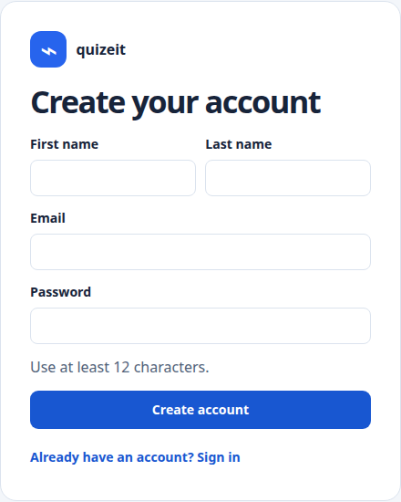
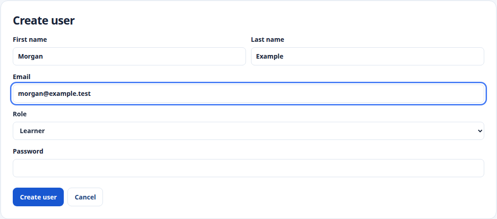

# Users

## Create your own account

1. Open the Quizeit sign-in page your organization uses and select **Create an account**.
2. Enter your first name, last name, email, and a password of at least 12 characters.
3. Select **Create account**. Quizeit signs you in as a **Learner** and opens your dashboard.
4. On your next visit, use **Sign in** with the same email and password.

If **Continue with Google** appears, you can use it to sign in. To connect Google to an existing password account, sign in with your password first, then open **Settings → Account → Connect Google**. If you received a personal exam link, follow [Take an invited exam](take-exam.md) to open your assigned exam.

## Create an account for another person

1. As an administrator or the owner, open **Users** and select **New user**.
2. Enter the person's **First name**, **Last name**, and **Email**. Use their own email address. Choose a **Role**, then enter a **Password** of at least 12 characters. **Learner** is the initial selection.
3. Select **Create user**. Give the person their sign-in details privately. Use [Candidate invitations](invitations.md) when someone only needs to sit an exam.

## Who can see and do what

**Owner** is the designated administrator account with additional account-management permissions. **Exam candidate** is access granted by a personal invitation.

| Area or action | Learner | Administrator | Owner | Exam candidate |
| --- | --- | --- | --- | --- |
| Dashboard, Practice exams, Question bank, and Attempt history | Shared practice material, own private material, and own history | Same access, plus submitted-media review | Same as administrator | Assigned exam only |
| Manage question sets | Create and edit own private practice sets | Create private or shared practice sets. Edit own private sets and shared sets | Same as administrator | — |
| Generate questions | Practice only | Practice and real exam banks | Practice and real exam banks | — |
| Exam question bank | — | View, create, edit, and delete exam question sets | Same as administrator | Sees assigned exam questions during the attempt |
| Real exams and Candidate invitations | — | Create exams, set grading, send or copy invitations, and review results and evidence | Same as administrator | Open own invitation and submit |
| Users | — | View the user list. Create, edit, deactivate, and restore learner accounts | Manage accounts and assign Administrator and available plugin roles | — |

An optional role such as **Practice results exporter** adds access to a specific feature. This role allows the account to download its own practice results. The owner can assign roles shown in **Users**.

If **Candidate invitations** is missing from your sidebar, ask an administrator or the owner to create and send the invitation. They can also check expired or already-used links.

## Edit, deactivate, or restore a user

- Open **Users** and use **Search users** to find an account by name, email, role, or status.
- Select **Edit** to update the account. Leave **New password (optional)** empty to keep the existing password. Select **Save user**. Email, password, or role changes require the affected person to sign in again. Changing a Google-linked email disconnects Google sign-in. Set a password first when Google is the account's only sign-in method.
- Select **Deactivate**, then **Confirm deactivation**, to sign the user out and block access. Their question sets and history are kept. Select **Restore** to allow sign-in again. These actions are available on accounts you can manage.

