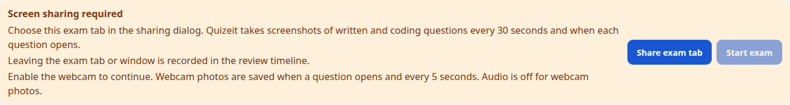
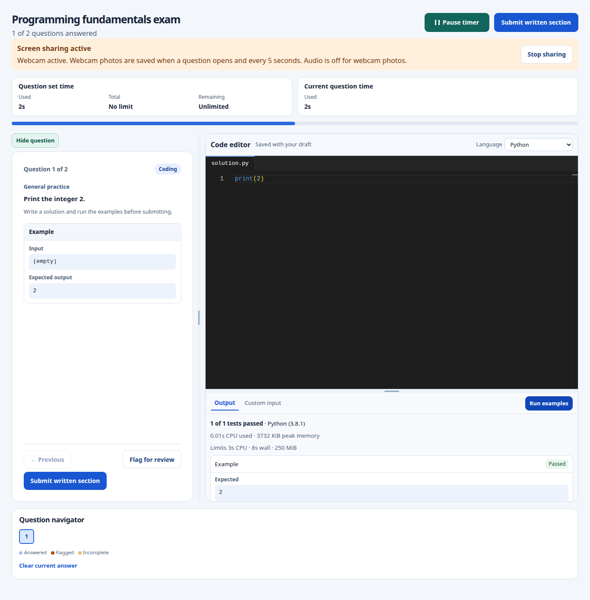
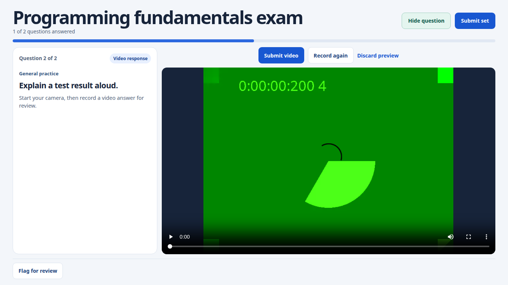

# Take an invited exam

## Open the invitation

Open the invitation in a supported desktop browser and enter your name and the email that received the link. Use **Continue to exam setup**. If you need to resume, reopen the exam in the same browser profile.

## Share your screen and enable the webcam

1. In Chrome or Edge, select **Share exam tab** and choose the tab displaying the exam. In Firefox, select **Share exam window** and choose the browser window displaying the exam.
2. Select **Enable webcam** and grant camera access when prompted.
3. Select **Start exam** once both checks pass. If access stops, follow the prompts to restore it. Stay in the exam window while answering. Quizeit records screenshots, webcam photos, and focus changes during the written and coding section.

## Answer and submit

Use **Previous**, **Next**, or the question navigator to move through the current section. Flag a question when you want to return to it. For a coding answer, pick a language, edit the code, and select **Run examples**. The editor saves code in your draft. Use **Custom input** to try different input.

In a mixed-format exam, **Submit and start video answers** locks the written and coding section. On a video question, select **Start camera**, check the preview and microphone, and select **Start recording**. Review the recording and choose **Submit video** to save it as your answer. Select **Submit exam** when you finish, and wait for **Exam submitted**.

